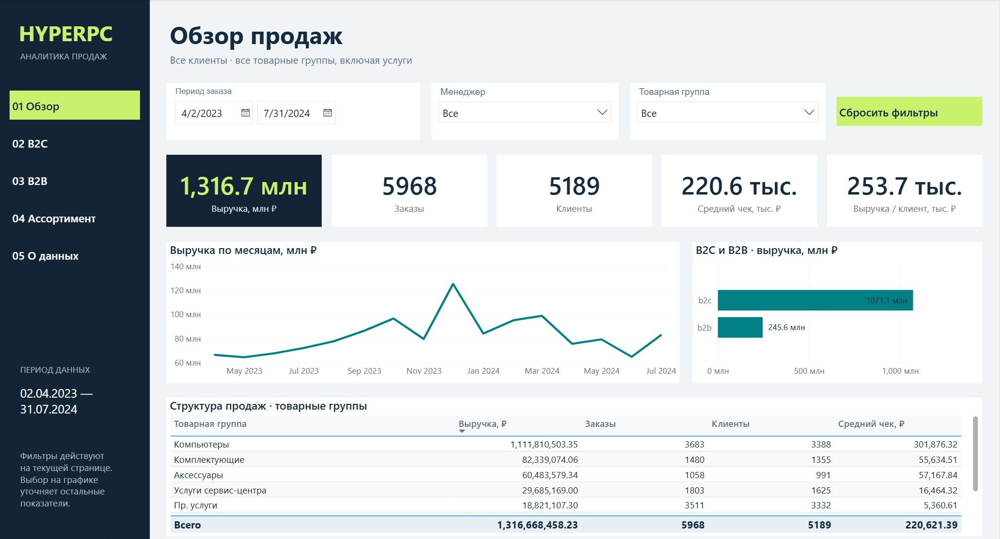
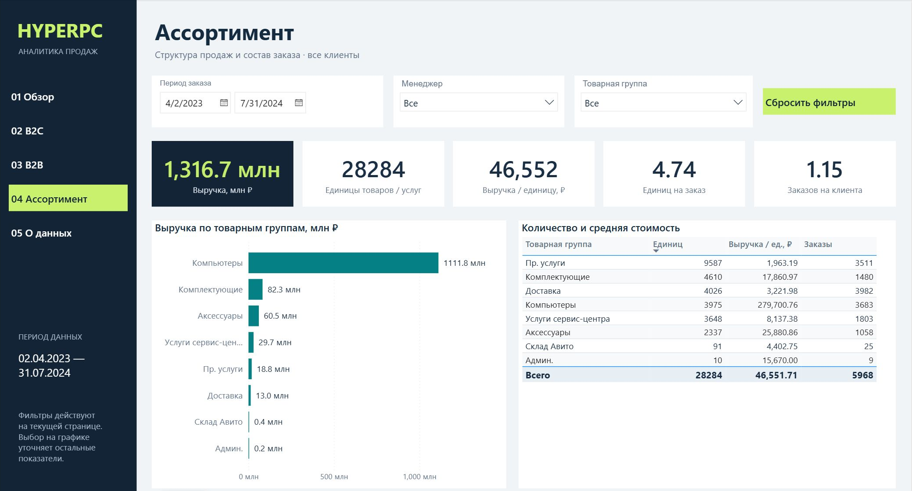

# HYPERPC · Sales & Customer Analytics

[← Danila Novikov · BI Portfolio](https://github.com/576e)

**Power BI · Power Query · DAX · RFM · ABC Analysis**

## Dashboard preview

### Sales overview

### Product assortment

## Objective

Bring sales, customer, and product analysis together in a report that lets users move from overall trends to individual segments and products.

## My Contribution

During my internship at Paper Planes, I independently prepared sales and customer data, built the data model, and developed visualizations and DAX measures, including revenue per customer and RFM segmentation.

## Current Report

Five overview pages cover sales, B2C, B2B, product assortment and data context. Six archived pages preserve the original detailed analysis. The saved period is 2 April 2023 to 31 July 2024. The overview shows revenue, orders, customers, average order value and revenue per customer. Filters select the period, manager and product group.

Revenue per customer is a historical average, not a prediction of lifetime customer value.

## Outcome

An analytical report connecting headline KPIs with customer behavior, product performance, and data quality checks. It supports trend exploration and hypothesis development; it does not measure the causal impact of business decisions.

## Open the dashboard

Download [the Power BI report](dashboard/HYPERPC.pbix) and open it in Power BI Desktop. The PBIX includes the saved data model, so you can explore the existing snapshot without refreshing. Data refresh requires access to the original sources and may require updating source paths.

The report is presented as a portfolio project. It is not an official product of the named organization.

